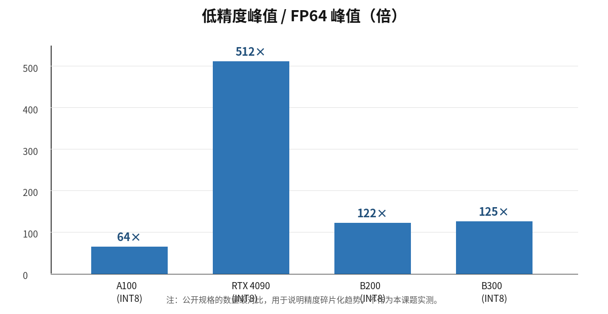
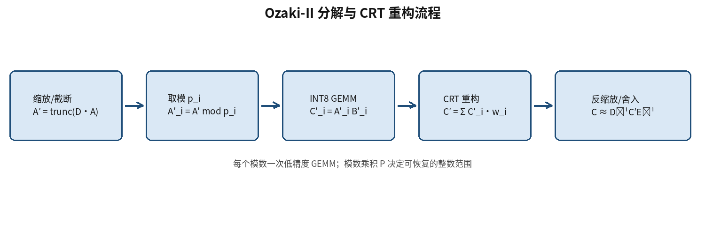
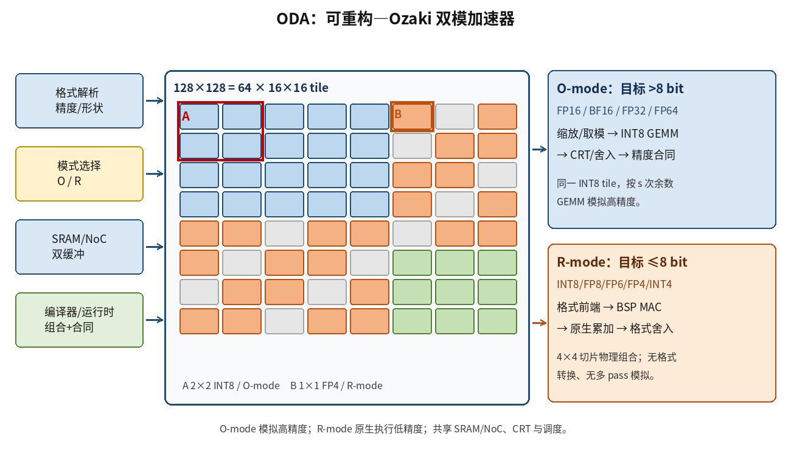
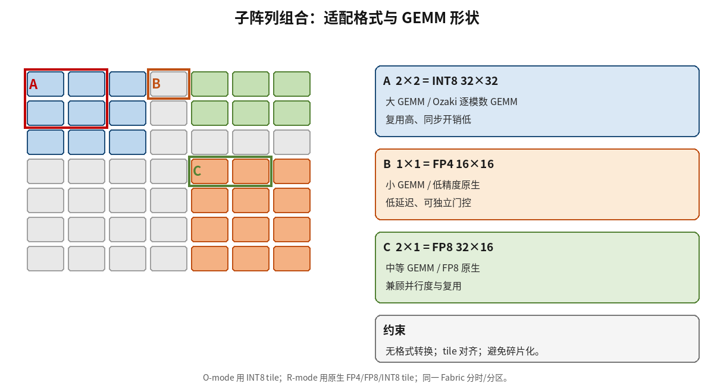
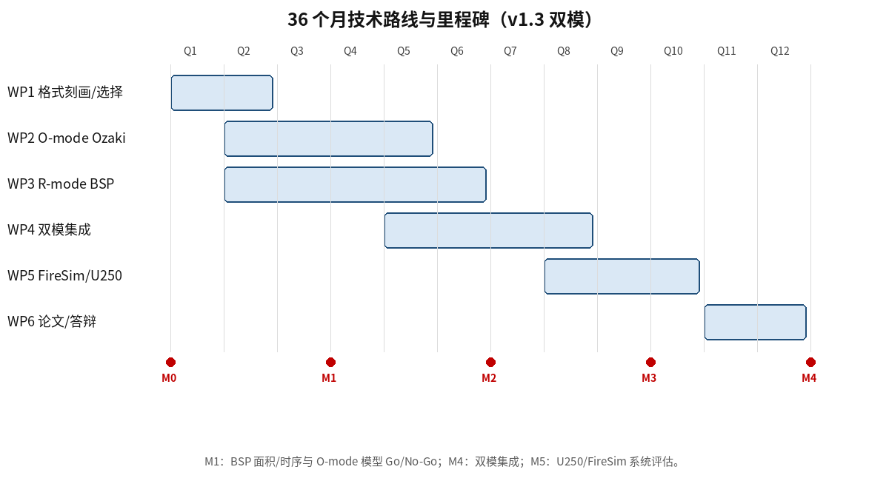

# 面向多格式 AI 计算的可重构—Ozaki 双模加速器关键技术研究

| 项目 | 内容 |
|---|---|
| 学科方向 | 计算机体系结构 / 多格式矩阵计算 / 算法—架构协同设计 |
| 文档性质 | 博士学位论文开题报告（36 个月路径） |
| 基准工作 | OzCore（MICRO 2026）、格式融合多精度阵列、原生低精度阵列 |
| 前一版 | 《面向多精度统一执行的 Ozaki 模拟 GEMM 加速器关键技术研究》v1.2 |
| 版本 / 日期 | v1.3 / 2026 年 11 月 |
| 前期基础 | P0/P0b INT8 基线、FP8/FP4 MAC 与 128×128 阵列实测、Ozaki-I/II 代价模型、OzCore artifact CPU 复现、Chipyard/FireSim 环境 |

---

## 对 v1.2 的修改说明

v1.2 的主线是 **INT8-only + Ozaki-II 高精度模拟**，把 FP8/FP4 降为可选扩展，创新点集中在精度合同、小矩阵非 GEMM 开销、存储/数据流与同面积评估。v1.3 按新的论文定位重构为 **双模架构**：高精度侧继续用 Ozaki 低精度模拟高精度，低精度侧改为**物理可动态重组的原生长通路**，并用 FireSim/U250 做系统验证。

| 维度 | v1.2 | v1.3 | 修改原因 |
|---|---|---|---|
| 研究定位 | 单一 INT8 阵列 + Ozaki，统一支持多精度 | **O-mode（Ozaki 高精度）+ R-mode（原生低精度）双模** | 低精度格式不应被高精度模拟路径“顺带”支持；FP4/INT8 需要原生效率 |
| 低精度格式 | FP8/FP4 为 WP6 可选扩展 | **FP8/FP6/FP4/INT8/INT4 为 R-mode 核心** | 低精度是独立主战场，不是高精度模拟的附属 |
| 数据通路 | 以 INT8 MAC 为唯一物理基 | **BSP（bit-sliced processing）lane + 可组合子阵列 Fabric** | 物理重组、直接执行，避免“用一种格式逼近另一种” |
| 创新点 | I1 精度合同；I2 小矩阵；I3 存储；I4 同面积/系统 | **三个论文点：Ozaki 高精度、原生可重组低精度、FireSim/U250 系统验证** | 与论文点一一对应，避免四条线过散 |
| 精度控制 | 独立创新点 | 保留为 O-mode 的支撑机制（合同/守卫/统计） | 高精度侧仍需可证明的误差界 |
| 系统验证 | I4 的一部分 | **论文点 3 的核心** | 双模价值必须在 CPU+加速器系统中验证 |
| 标题 | 面向多精度统一执行的 Ozaki 模拟 GEMM 加速器 | **面向多格式 AI 计算的可重构—Ozaki 双模加速器** | 从“单一模拟引擎”转为“双模协同” |

**v1.3 的三句话版本**：

1. **8 位以上**（FP16/BF16/FP32/FP64）用 Ozaki-II 在低精度整数阵列上模拟高精度，精度由分解次数/模数集控制，而不是为每种格式造一套高精度 MAC；
2. **8 位及以下**（INT8/FP8/FP6/FP4/INT4）用**物理可动态重组的数据通路**直接执行，靠 BSP lane 与 16×16 子阵列的组合适配格式与 GEMM 形状，不用其中一种格式去逼近另一种；
3. 用 **Chipyard + FireSim + Alveo U250** 搭 CPU+ODA 的可运行原型，验证双模切换、子阵列组合、精度合同与端到端收益。

> 边界说明：本文以 8 bit 为分界。FP8 默认属于低精度侧、走 R-mode；当 FP8 被用作 Ozaki 的物理基时，它是 O-mode 的内部实现选择，不改变“FP8 原生可执行”的结论。INT8 同时是 R-mode 的原生格式和 O-mode 的主基。

---

## 摘要

大模型与科学计算同时要求 FP64/FP32/FP16/BF16/FP8/FP4/INT8 等多格式矩阵乘，而芯片的峰值算力与面积效率持续向低精度迁移。现有两条路线各有硬伤：**格式融合**在同一个 MAC 中复用多套乘法/指数/累加逻辑，每增加一种格式就增加一份长期空闲的硬件，面积随格式数增长；**单一格式 + 模拟**（如 OzCore 的 INT8-only + Ozaki-II）能以较低面积支持高精度，但低精度格式仍要经过高精度模拟的多 pass 流程，FP4/INT8 的原生效率被牺牲。

本课题提出 **ODA（Ozaki–Dual-mode Accelerator，双模加速器）**：以 128×128 的可组合子阵列 Fabric 为物理载体，按目标精度把工作负载分到两条通路。

- **O-mode（高精度侧，目标 >8 bit）**：用 Ozaki-II 把 FP16/BF16/FP32/FP64 GEMM 分解为若干次精确整数 GEMM，在 INT8 子阵列上执行，再用 CRT 重构；以模数集/分解次数 s、尺度不变缩放、精度合同（EXACT/BOUNDED/FAST）与守卫控制误差和吞吐。低精度阵列模拟高精度，避免为 FP64/FP32 造大面积原生单元。
- **R-mode（低精度侧，目标 ≤8 bit）**：用 **BSP lane**（8×8 乘法器由 4×4 切片物理组合）与 **16×16 子阵列**直接执行 INT8/FP8/FP6/FP4/INT4；子阵列可按 1×1、2×1、2×2、4×4 动态组合，适配不同 GEMM 形状与并行度；格式前端、指数/舍入与累加按原生格式工作，**不做格式转换、不用一种格式逼近另一种**。
- **统一层**：两种模式共享 SRAM/NoC、CRT/舍入资源与调度器；编译器按格式、形状、精度合同与负载混合比选择模式，并在 tile 级组合子阵列，目标是把模式切换与重组开销压到 <5%。

课题按博士 36 个月规划，设置 M0–M6 里程碑，以“模型—RTL—模拟—FPGA 系统”四条线迭代。前期已完成 P0/P0b INT8、FP8/FP4 MAC 与 128×128 阵列的 TSMC 28 nm 实测、Ozaki-I/II 代价模型与 OzCore artifact 的 CPU 复现；已具备 Chipyard/FireSim 环境。预期形成可综合 RTL、周期级模拟器、双模编译器/运行时、FireSim-on-U250 原型与 2–3 篇高水平论文。

**关键词**：多格式计算；Ozaki Scheme II；可重构数据通路；子阵列组合；FP4/INT8；FireSim；同面积评估

---

## 第 1 章 绪论

### 1.1 研究背景与意义

过去十年，矩阵引擎的峰值算力持续向低精度迁移。以公开规格为例，A100 的 INT8 峰值约为 FP64 的 64 倍，RTX 4090 达到 512 倍，B200 为 122 倍；面向 AI 的 B300 把 INT8 削减到约 150 TOPS、FP64 仅约 1.2 TFLOPS，同时把 FP4 提升到 14 PFLOPS 量级；Rubin 一代延续该趋势。与此同时，HPC 与科学计算仍依赖 FP64，LLM 训练/推理则混合使用 BF16、FP8、FP4 与 INT8。**精度碎片化**与**FP64 算力危机**成为体系结构必须同时面对的两个事实。

传统方案是数据通路融合（datapath fusion）：在一个 MAC 中复用乘法器、符号/指数/累加逻辑，支持多种格式。但每增加一种格式，就增加一份在大多数时间空闲的硬件，持续稀释单位面积算力。另一条路线是领域专用：只做一种格式，牺牲灵活性与互操作性。Ozaki 方案给出了第三条路：**用低精度整数运算模拟高精度浮点**，精度由分解次数而不是数据通路决定。OzCore 已经把这条路线做成 INT8 阵列 + CRT 后端的可综合架构，证明“整数阵列可以统一支持高精度”。

但 OzCore 的“统一”只覆盖了高精度侧。对 FP4、FP8、INT8 这些低精度格式，若仍走 Ozaki 的多 pass 模拟，会付出不必要的分解、取模、CRT 与存储开销；若为每种低精度格式单独造阵列，又回到格式融合的面积税。**高精度侧需要“模拟”，低精度侧需要“原生”；两者应在同一芯片上按负载动态共存，而不是二选一。** 这正是本课题的出发点。



### 1.2 国内外研究现状

**算法侧：Ozaki 与高精度模拟。** Ozaki I 沿尾数切片，GEMM 次数随切片数平方增长；Ozaki II 用 CRT，GEMM 次数随模数线性增长，是当前高精度模拟的主流。2026 年的三项进展进一步完善工程可用性：FP8 量化版用 3 次 FP8 GEMM/模数、12–13 个模数达到 FP64；FP4 base-13 版用 19 个模数、75 次 FP4 GEMM；fast-mode 缩放改进指出现有 fast 公式缺乏尺度不变性，并给出零额外开销的修正。软件实现方面，GEMMul8、ozIMMU、cuBLAS 13.x 的 FP64 emulation + ADP、Intel Arc Xe2 的 Ozaki-II 实现，已经把“算法可行”推进到“产品可用”。

**硬件侧：格式融合与可重构阵列。** Bitfusion 用位级可组合乘法器支持不同位宽；Stripes 用位串行时变精度；BitWave 用位级可重构阵列；Laconic 面向 FPGA 的量化精度；UNPU 用可变权重位精度；Gemmini 提供 systolic 阵列的软硬件栈。这些工作证明了“同一阵列可通过位宽/精度配置支持多格式”，但多数是**格式级可重构**或**位串行**，并不区分“高精度模拟”和“低精度原生”两条语义；对 FP4 的指数/舍入、INT8 的精确累加、以及子阵列级组合调度，缺少统一处理。

**系统侧：FireSim 与 FPGA 原型。** Chipyard 提供 Rocket/BOOM + 加速器的 SoC 生成框架；FireSim 在 Alveo U250 等 FPGA 上做周期精确的 FPGA 加速模拟，能跑完整 CPU+加速器+存储层次。已有工作多用 FireSim 验证 SoC/存储/系统软件，但很少用它验证“多格式加速器的双模切换与子阵列组合”。本课题把 FireSim/U250 从“可选 demo”提升为论文点 3 的核心证据。

### 1.3 现有工作的不足与本课题的切入点

**不足 1：低精度格式被高精度模拟“绑架”。** OzCore 的 INT8-only + Ozaki 对 FP64/FP32 很合理，但对 FP4/INT8 目标，多 pass 分解与 CRT 是不必要的；低精度负载需要 1 次原生 GEMM，而不是用高精度路径“顺带”支持。

**不足 2：格式融合的面积税与细粒度重组开销。** 在每个 MAC 内融合多种格式，面积随格式数增长；位级可重构（Bitfusion/Stripes）能省面积，但位串行/移位开销会牺牲低精度峰值。需要**粗粒度（子阵列/tile）物理重组**：格式专用 datapath + 可组合 tile，在面积、峰值、切换开销之间取平衡。

**不足 3：缺少“高精度模拟 + 低精度原生”的统一架构与调度。** 现有工作要么只做 Ozaki，要么只做多格式阵列；没有回答“给定格式、形状、精度合同与混合负载，何时走 O-mode、何时走 R-mode、如何分/合子阵列”。

**不足 4：缺少 CPU+加速器的可运行系统验证。** 多数结果停留在 kernel 级模拟或综合；双模切换、tile 组合、精度回读对系统软件/存储/调度的真实影响没有端到端证据。

**切入点**：以 128×128 可组合子阵列 Fabric 为物理载体，O-mode 复用 INT8 子阵列做 Ozaki，R-mode 用 BSP lane 原生执行 ≤8 bit 格式；用统一调度器在 tile 级分/合，最后用 FireSim-on-U250 验证。**不是把 OzCore 推倒重来，而是把“高精度模拟”和“低精度原生”放进同一芯片、同一编程模型、同一评估框架。**

### 1.4 研究问题

- **RQ1（高精度侧）**：给定目标格式（FP16/BF16/FP32/FP64）、矩阵形状、动态范围与精度合同，如何选择 Ozaki 基（INT8/FP8）、模数集与分解次数 s，使“GEMM + 变换 + CRT + 存储”的总面积—能耗—延迟最优？
- **RQ2（低精度侧）**：如何用 BSP lane 的 4×4 切片与 16×16 子阵列，物理地组合出 INT8/FP8/FP6/FP4/INT4 的原生数据通路，使每种格式接近其原生峰值，同时把重组/门控/碎片开销压到可接受范围？
- **RQ3（双模协同）**：给定混合精度负载与精度合同，如何在 tile 级划分 O-mode/R-mode、组合子阵列、调度 GEMM 与数据搬运，使双模相对单模/OzCore/格式融合基线在同面积下占优？
- **RQ4（系统价值）**：在 Chipyard + FireSim/U250 的 CPU+ODA 系统中，双模切换、子阵列组合与精度合同回读的端到端开销是多少？同面积/同精度/同带宽下，ODA 的 Pareto 优势区间在哪里？

### 1.5 研究内容与三个论文点

本课题围绕三个论文点展开（第 3 章展开，第 4 章给技术路线）：

1. **论文点 1：高精度侧的 Ozaki 低精度模拟。** 以 INT8 为主基，研究模数集/分解次数 s 的选择、尺度不变缩放、CRT 重构、精度合同与守卫；目标是在不造原生 FP32/FP64 阵列的前提下，让 FP16/BF16/FP32/FP64 达到可证明的误差界与有竞争力的面积—能耗。相对 OzCore 的增量是**双模上下文中的精度合同、与低精度侧的共享资源、以及同面积对照**，不是重复 Ozaki 算法本身。
2. **论文点 2：低精度侧的物理可动态重组数据通路。** 设计 BSP lane（8×8 乘法器由 4×4 切片组合）与 16×16 子阵列，支持 INT8/FP8/FP6/FP4/INT4 的原生执行；子阵列可按 1×1、2×1、2×2、4×4 组合，适配 GEMM 形状与并行度；研究物理重组（配置/时钟/电源门控）、格式前端、原生累加与舍入，以及“无格式转换”的约束。相对格式融合/位串行阵列的增量是**子阵列级异构组合 + 原生低精度语义**。
3. **论文点 3：FireSim + Alveo U250 的系统原型与同面积评估。** 用 Chipyard 生成 Rocket/BOOM + ODA 的 SoC，在 FireSim/U250 上跑 CPU+加速器的端到端负载；U250 用 32×32/16×16 缩比阵列（完整 128×128 约 16K MAC，资源放不下），全尺寸用 FireSim/ASIC 综合评估；验证双模切换、子阵列组合、精度合同回读与同面积 Pareto。

### 1.6 论文组织结构

第 1 章绪论；第 2 章技术基础与基线；第 3 章研究目标与三个论文点；第 4 章研究内容与技术路线；第 5 章实验方案与评估；第 6 章进度安排；第 7 章预期成果；第 8 章风险与应对；参考文献与附录 A。

---

## 第 2 章 技术基础与基线

### 2.1 精度谱与两条执行路线

本文把目标格式按 8 bit 分界，形成表 1 的执行映射。关键点不是“8 bit 这个数字”，而是**精度语义**：>8 bit 需要比低精度阵列更宽的尾数/指数，适合用 Ozaki 模拟；≤8 bit 的格式本身就可以在低精度乘法器/累加器上原生执行，适合 R-mode。

| 目标格式 | 位宽 | 默认模式 | 物理基/数据通路 | 说明 |
|---|---:|---|---|---|
| FP64 | 64 | O-mode | INT8 子阵列 + CRT | s≈15（INT8 基，工程口径） |
| FP32 | 32 | O-mode | INT8 子阵列 + CRT | s≈8 |
| FP16/BF16 | 16 | O-mode | INT8 子阵列 + CRT | s≈3–4 |
| FP8 E4M3/E5M2 | 8 | R-mode（可作 O-mode 基） | BSP lane 原生 | 1 次原生 GEMM；作基时 3 次/模数 |
| FP6 | 6 | R-mode | BSP lane 原生 | 4×4/6-bit 切片组合 |
| FP4 E2M1 | 4 | R-mode | BSP lane 原生 | 1 次原生 GEMM |
| INT8 | 8 | R-mode / O-mode 基 | BSP lane 原生 / INT8 子阵列 | 原生 1 次；O-mode 逐模数 GEMM |
| INT4 | 4 | R-mode | BSP lane 原生 | 1 次原生 GEMM |

表 1 中的 s 是工程口径，不是固定常数；第 3.2 节给出选择模型与精度合同。

### 2.2 Ozaki Scheme II 与 CRT

给定 FP 矩阵 A∈R^{m×k}、B∈R^{k×n}，Ozaki II 分四步：

1. **缩放**：用 2 的幂行/列缩放 D、E 把 A、B 截断为整数 A′=trunc(D·A)、B′=trunc(B·E)，使整数乘积落在 CRT 可表示范围内；
2. **模分解**：选两两互素模数 p₁…p_s，对每个模数取对称余数 A′ᵢ=A′ mod pᵢ、B′ᵢ=B′ mod pᵢ；
3. **整数 GEMM**：在低精度阵列上计算 C′ᵢ=A′ᵢB′ᵢ；对 INT8 基，内维 q<2¹⁷ 时 INT32 累加精确；
4. **CRT 重构**：C′ ≡ Σᵢ C′ᵢ·(P/pᵢ)·yᵢ (mod P)，P=∏pᵢ；再反缩放并舍入到目标格式。

达到目标有效位 b 所需的模数/GEMM 次数由 CRT 容量与内维决定。对于 FP64（b=53），INT8 基约需 14–16 个模数（容量/工程口径），FP8 基约 12–13 个模数（每模数 3 次 GEMM，36–39 次），FP4 base-13 基 19 个模数（75 次 GEMM）。本课题前期用位预算 + 数值仿真复核了这些数字（附录 A）。



### 2.3 低精度原生格式与可重构阵列

低精度格式的原生执行不是“把 FP4 当作 INT4”或“把 INT8 当作两个 FP4”：FP4 有符号/指数/尾数/特殊值，INT8 是定点补码，二者的语义、累加宽度、舍入与异常处理不同。R-mode 必须为每种格式保留**原生格式前端 + 原生乘法/累加 + 原生舍入**，否则就是“用一种格式逼近另一种”，会在动态范围、NaN/Inf、饱和与精度上出问题。

可重构阵列的已有做法分三类：

- **位级可组合**（Bitfusion、BitWave）：把乘法器拆成位级单元，按位宽组合；灵活但移位/布线开销大，低精度峰值受损；
- **位串行/时变精度**（Stripes、UNPU）：按位串行处理，面积小但延迟随位宽增长；
- **格式级融合**（Laconic、Gemmini 的量化支持、GPU tensor core）：每种格式一套 datapath，靠软件选择；面积随格式数增长。

本课题取第四类：**粗粒度物理重组**。BSP lane 把 8×8 乘法器拆成 4 个 4×4 切片；INT8 用全部切片（含移位/相加），FP4/FP6/FP8 用部分切片 + 原生指数/舍入。子阵列（16×16）是重组单位：每个 tile 可配置为 INT8/FP8/FP6/FP4 人格，tile 之间可组合成更大的逻辑 tile。这样既保留原生语义，又把重组开销限制在 tile 级，而不是每个 MAC 内的细粒度 mux。

### 2.4 OzCore 基线

OzCore 的核心贡献可归纳为四点：

1. **全整数化 Ozaki-II 流水线**：预处理、模归约、CRT 重构都不再依赖 FP64/FP32，显著降低控制逻辑面积；
2. **更紧的缩放界**：减少输入预处理阶段的尾数截断误差，从而减少达到目标精度所需的 INT8 GEMM 次数；
3. **INT8 GEMM 引擎 + 可重构 CRT**：12 个 CRT slot，支持 s∈{2,3,4,6,12} 的运行时切换；相对 INT8 阵列仅增加 27.9% 前/后处理面积；
4. **等精度评估**：相对融合 FP16/BF16/FP8/INT8 的多格式基线，取得 1.91× TOPS/mm²、1.40× TOPS/W；在 LLaMA-3.1 8B/70B 上 s=3 匹配 BF16 困惑度。

OzCore 已经回答了“整数阵列能不能统一支持高精度”，但没有回答低精度原生、双模协同与系统验证。因此本课题把 OzCore 作为**高精度侧的基线**，而不是重复实现；低精度侧则与格式融合/原生阵列基线比较。

### 2.5 与 OzCore、格式融合基线的逐项对比

| 维度 | OzCore | 格式融合阵列 | 本课题 ODA |
|---|---|---|---|
| 高精度（>8 bit） | INT8 + Ozaki，成熟 | 原生 FP32/FP64 或融合 | O-mode：复用 INT8 子阵列 + Ozaki |
| 低精度（≤8 bit） | 仍走 Ozaki 多 pass | 每种格式一套 datapath | R-mode：BSP lane 原生执行 |
| 物理重组 | 无（固定 INT8） | 格式级 mux/融合 | 16×16 tile 级配置 + 子阵列组合 |
| 面积 | 阵列 + 27.9% 前/后处理 | 随格式数增长 | BSP 切片共享 + tile 级门控 |
| 精度控制 | s 寄存器 | 格式固定 | O-mode 精度合同；R-mode 原生语义 |
| 系统验证 | 无 CPU+加速器原型 | 多为 kernel/模拟 | Chipyard + FireSim/U250 |
| 主要风险 | 低精度效率 | 面积税/空闲硬件 | BSP 面积/时序、tile 碎片 |

### 2.6 前期实测数据

所有数据来自 TSMC 28 nm HPC+ FF、Design Compiler O-2018.06-SP1、1 GHz 或标注频率；详细脚本见 `experiments/`。

| 项目 | 面积 | 能量/功耗 | 说明 |
|---|---:|---:|---|
| INT8 MAC | 378.13 µm² | 0.366 pJ | P0b，365 cells，CP 1.13 ns |
| FP8 E4M3 MAC | 619.42 µm² | 0.315 pJ | 1.64× INT8 面积 |
| FP4 E2M1 MAC | 551.25 µm² | 0.200 pJ | 1.46× INT8 面积 |
| FP16 MAC（参考） | 921.19 µm² | 0.667 pJ | 2.44× INT8 面积 |
| 128×128 INT8 阵列 | 5.903 mm² | 1.800 W* | 8×8 tile 实测 + 256 tile 组合 |
| 128×128 FP8 阵列 | 10.765 mm² | 1.549 W | 同上 |
| 128×128 FP4 阵列 | 9.633 mm² | 0.982 W | 同上 |

\* 功耗为单 lane 默认活动率能量 × 16384 的模型值；tile DC 功耗不随 lane 线性缩放，未直接采用。

**Ozaki 代价（工程口径，INT8 基）**：BF16/FP16/FP32/FP64 分别约 4/4/8/15 次 INT8 GEMM；FP8 基约 9/12/18/39 次；FP4 base-13 约 9.9/11.9/19.8/37.5 次。等精度成本 INT8 基最优，FP4 为 1.96–2.36×，FP8 为 3.17–4.23×（单 lane）；阵列级 FP4 2.20–2.64×、FP8 3.53–4.71×。

**结论**：在 28 nm 自研 ASIC 上，INT8 是高精度模拟的最优基；FP4 的原生能量最低（0.200 pJ），但面积大于 INT8；FP8 面积最大。因此 R-mode 不能简单“全用 FP4”或“全用 INT8”，而要靠子阵列组合按格式/形状适配——这正是论文点 2 的动机。

---

## 第 3 章 研究目标与三个论文点

### 3.1 总体目标

证明“高精度模拟 + 低精度原生”的双模架构在同面积、同精度、同带宽约束下，相对 OzCore（单模模拟）与格式融合阵列具有可辩护的 Pareto 优势，并交付可综合、可复现、可运行的系统原型。目标分三层：

| 层次 | 交付物 | 验收标准 |
|---|---|---|
| L1 模型与算法 | 格式—模式—代价模型；O-mode 模数/s 选择；R-mode 组合规则 | 复现文献 ≥80% 数字；给出目标工艺 Go/No-Go |
| L2 架构与仿真 | BSP lane、子阵列 Fabric、双模调度器、周期级模拟器 | BSP 面积开销 ≤20%（相对 INT8）；模拟器 vs RTL 误差 <5% |
| L3 原型与评估 | 可综合 RTL；Chipyard/FireSim/U250 原型；软件栈 | 双模切换开销 <5%；端到端相对基线 ≥1.3×（目标） |

### 3.2 论文点 1：高精度侧的 Ozaki 低精度模拟

**问题**：>8 bit 的目标格式（FP16/BF16/FP32/FP64）若造原生 MAC，面积/能耗随尾数宽度快速增长；若用低精度阵列模拟，需要回答“用哪种基、多少模数/分解次数、怎样保证误差界、何时比原生更划算”。

**研究内容**：

1. **基与模数集选择**：以 INT8 为主基，建立“目标精度 b、内维 K、动态范围、CRT 容量”到模数个数 s 与模数集的映射；给出 s_min 的位预算下界与工程修正；对比 FP8 基（3 次/模数）与 INT8 基（1 次/模数）的交叉点。
2. **尺度不变缩放与精确性**：采用尺度不变缩放/截断，避免 fast-mode 的尺度依赖；用 CRT 唯一性条件 `P/2 > max|A′B′|` 做守卫；对溢出/越界自动增大 s 或回退。
3. **CRT 重构与舍入**：宽整数（128-bit 以上）加权累加、mod P、反缩放与正确舍入；把 CRT epilogue 与 GEMM 流水重叠，降低小/中矩阵的非 GEMM 开销。
4. **精度合同**：定义 EXACT（缩放后整数精确、最终一次正确舍入）、BOUNDED(ε)（相对误差 ≤ε）、FAST（固定 s）三级合同；硬件按合同选 s/模数/分块；提供 ulp 统计、正确舍入比例与越界回退记录，供应用回读。
5. **与低精度侧共享资源**：O-mode 复用 R-mode 的 INT8 tile、SRAM/NoC 与部分舍入资源；研究共享带来的带宽/端口冲突与隔离策略。

**与 OzCore 的差异**：OzCore 已有 s∈{2,3,4,6,12} 与整数化前/后处理；本论文点不是重复这些，而是把精度从“选 s”升级为**应用级合同 + 守卫 + 统计**，并在双模架构中与 R-mode 共享 tile/存储；同时补同面积原生 FP32/FP64 对照。

**验证**：

- 数值：对 MPFR 黄金模型，EXACT 模式逐元素一致（在约定异常/特殊值范围内）；BOUNDED(ε) 的误差分布与守卫触发率；
- 性能：LLaMA-3.1 8B/70B 的 WikiText-2 PPL 与 BF16 基线对比（s=3/4）；FP32/FP64 GEMM 的有效吞吐；
- 面积/能耗：O-mode 相对原生 FP32/FP64 阵列的同面积加速比；相对 OzCore 的同工艺对比；
- 小矩阵：K=1024–4096 的非 GEMM 开销与 CRT 重叠效果。

### 3.3 论文点 2：低精度侧的物理可动态重组数据通路

**问题**：≤8 bit 的格式（INT8/FP8/FP6/FP4/INT4）需要原生执行，但为每种格式造一套完整阵列会面积税；位级可重构又会牺牲低精度峰值。怎样在“原生语义”和“面积效率”之间取平衡？

**核心思想：BSP lane + 可组合子阵列 Fabric。**

- **BSP lane**：一个 8×8 有符号乘法器由 4 个 4×4 切片组成。INT8 模式用全部切片（部分积移位/相加）；FP8/FP6/FP4 模式用 4×4（或 4×2/2×2）切片 + 原生指数/符号/舍入单元。切片是物理复用的，不是“用 INT8 逼近 FP4”；每种格式有自己的前端、累加宽度与舍入。
- **16×16 子阵列**：128×128 物理阵列 = 64 个 16×16 tile。每个 tile 有独立配置寄存器，选择格式人格（INT8/FP8/FP6/FP4/INT4）与电源/时钟门控；tile 内 lane 共享权重/激活广播与累加树。
- **子阵列组合**：tile 可组合为 1×1（16×16）、2×1（32×16）、2×2（32×32）、4×4（64×64）逻辑 tile；小 GEMM 用 1×1 降延迟，大 GEMM 用 2×2/4×4 提高复用；混合负载可在空间上分区，不同 tile 同时跑不同格式。
- **物理重组**：配置在 kernel/tile 边界完成；tile 级 clock/power gating；双缓冲权重/激活；重组时 drain 当前 tile，目标开销 <5%（K≥512）。不进行格式转换（无 FP4→INT8、INT8→FP4 的数值转换）。
- **原生格式前端**：FP4/FP6/FP8 的符号/指数/尾数解码、特殊值处理、累加对齐与舍入在 tile 前端完成；INT8/INT4 用定点补码路径；两种路径共享乘法切片与部分累加树。

**关键研究问题**：

1. 4×4 切片组合成 8×8 乘法器的面积/时序开销；与原生 INT8 乘法器相比，BSP 的面积是否 ≤1.2×、关键路径是否可收敛到 1 GHz？
2. FP4/FP6/FP8 的原生指数/舍入逻辑占 tile 面积的比例；是否值得为每种格式保留独立前端，还是用可配置微码？
3. tile 组合的碎片化：当 GEMM 形状与 tile 边界不齐时，利用率损失多少？调度器如何选择 1×1/2×2/4×4？
4. 混合负载下，空间分区 vs 时间复用的切换开销与吞吐；双模共享 SRAM/NoC 的隔离。

**与已有工作的差异**：Bitfusion/Stripes/BitWave 主要做位级/位串行可重构，低精度峰值与格式语义（FP4 指数/NaN）处理不足；格式融合阵列面积随格式数增长；本工作用**粗粒度 tile 组合 + BSP 切片**，在保留原生语义的同时把重组限制在 tile 级，并用双模调度与 O-mode 共享物理资源。

**验证**：

- 综合：BSP lane / 16×16 tile 在 TSMC 28 nm 的 area/CP/energy，对比原生 INT8/FP4/FP8 tile；BSP 相对 INT8 的面积开销；
- 功能：INT8/FP4/FP6/FP8 的逐元素对比黄金模型（含特殊值/饱和/舍入）；
- 性能：每种格式的原生 GEMM 吞吐/能效；组合 1×1/2×2/4×4 的利用率；重组开销；
- 对比：与格式融合阵列、原生单格式阵列、O-mode 模拟低精度（若有）对比。

### 3.4 论文点 3：FireSim + Alveo U250 的系统原型与同面积评估

**问题**：双模架构的收益是否能在 CPU+加速器的真实系统中成立？tile 组合、模式切换、精度合同回读对端到端延迟/吞吐/能效的影响是多少？

**研究内容**：

1. **Chipyard SoC**：Rocket/BOOM CPU + ODA 加速器（RoCC 或 DMA 队列）+ 共享存储；实现 `oda_gemm` 驱动/运行时；支持 O-mode/R-mode 选择、tile 组合配置、精度合同回读。
2. **FireSim/U250 原型**：U250 资源放不下完整 128×128（约 16K MAC），用 32×32 或 16×16 缩比阵列做 FPGA 加速模拟；完整 128×128 用 FireSim 的周期精确模型 + TSMC 28 nm 综合面积/功耗评估；两者共享同一 RTL/配置。
3. **双模调度**：编译器/运行时按格式、形状、精度合同与混合比选择模式；tile 级分区；双缓冲；模式切换的 drain/refill 开销测量。
4. **端到端负载**：LLaMA 推理的 GEMM 序列（prefill/decode）、CNN/视觉、科学计算（FP32/FP64 GEMM）、混合精度负载；与 OzCore、格式融合、原生单格式、GPU 软件模拟对比。
5. **同面积评估**：综合 INT8/FP32/FP64 MAC 与阵列，标定 a₃₂/a₆₄；把基线缩放到与 ODA 同面积，比较有效吞吐、能效、精度；给出“格式 × 形状 × 精度”的 Pareto/Go-No-Go。

**与 OzCore 的差异**：OzCore 没有 CPU+加速器原型；本论文点补上系统级证据，并把双模切换/子阵列组合作为可测量对象，而不是只报 kernel 加速比。

**验证/指标**：

- 端到端延迟/吞吐/能效；CPU 侧驱动开销；DMA/队列开销；
- 模式切换与 tile 重组开销（cycles、%）；tile 利用率/碎片率；
- 精度合同回读正确性；与 MPFR/GPU 的误差对比；
- 同面积下相对 OzCore/融合/原生阵列的 Pareto。

### 3.5 三个论文点的关系与新颖性主张

三者不是并列堆叠，而是**一条闭环**：

```
格式/精度/形状 → 模式选择 → O-mode（Ozaki）或 R-mode（BSP 原生）
                      ↓
               tile 组合 + 双模调度
                      ↓
          FireSim/U250 系统验证 + 同面积评估
```

- 论文点 1 解决“高精度怎么便宜”；
- 论文点 2 解决“低精度怎么原生、怎么重组”；
- 论文点 3 解决“双模在系统里是否真的划算”。

**谨慎的新颖性主张**：

1. 据我们所知，尚未有工作把“Ozaki 高精度模拟”和“≤8 bit 原生可重组子阵列”放进同一物理 Fabric，并在 tile 级做双模组合与调度；本课题的增量是**双模共存 + 子阵列组合 + 系统验证**，不是 Ozaki 算法或格式融合本身。
2. BSP lane 的 4×4 切片组合与 16×16 tile 人格化，是针对“原生语义 + 粗粒度重组”的微架构方案；相对位级可重构，重点在低精度峰值与格式语义；相对格式融合，重点在面积/门控与 tile 组合。
3. 用 FireSim/U250 验证双模切换、tile 组合与精度合同回读，是把架构主张推进到系统级证据的必要一步；不宣称“首个”，只宣称“可综合 RTL + 同面积 + 系统”的组合。

所有“首次/首个”表述在投稿前做 FTO 与相关工作核查；若已有重叠，改为限定表述。

---

## 第 4 章 研究内容与技术路线

### 4.1 ODA 总体架构

ODA 由四部分组成（图 3）：

1. **统一前端**：格式解析、目标精度/形状、模式选择；把 GEMM 描述符翻译成 O-mode 或 R-mode 的 tile 任务；
2. **可组合子阵列 Fabric**：128×128 = 64 个 16×16 tile；每个 tile 可配置为 INT8/FP8/FP6/FP4/INT4 人格，支持 1×1/2×1/2×2/4×4 组合；
3. **两条执行通路**：O-mode 的缩放/取模 → INT8 GEMM → CRT/舍入；R-mode 的格式前端 → BSP MAC → 原生累加/舍入；
4. **共享资源**：SRAM/NoC、双缓冲、CRT/舍入单元、调度器、精度合同/统计。



**设计原则**：

- **物理共享、语义分离**：O-mode 与 R-mode 共享 tile/SRAM/NoC，但格式语义与舍入路径分离；不用一种格式的语义去近似另一种。
- **粗粒度重组**：以 16×16 tile 为重组单位，避免每 MAC 的细粒度 mux/移位开销；tile 内 BSP 切片做乘法器级复用。
- **模式按负载选择**：同一 kernel 内可按层/GEMM 选择模式；混合负载可在 tile 级空间分区，也可时间复用。
- **可观测**：模式、tile 组合、精度合同、切换开销都可回读，供编译器/应用决策。

### 4.2 格式/模式选择模型

给定 GEMM（m,n,k）、目标格式 f、精度合同 c、混合负载比例，选择模式与 tile 组合，使总代价最小：

```
Cost(mode, tile) = T_compute + T_transform + T_reconfig + T_memory
```

- **O-mode**：`T_compute ≈ s(f,c) · m·n·k / P_INT8`；`T_transform ≈ T_scale + T_mod + T_CRT`；`s` 由目标精度、模数集与守卫决定。面积代价是 INT8 阵列 + 前/后处理（参考 OzCore 的 27.9%）。
- **R-mode**：`T_compute ≈ m·n·k / P_f`（每种格式 1 次原生 GEMM）；`T_transform` 仅格式前端/舍入；`T_reconfig` 是 tile 配置/drain 开销。面积代价是 BSP lane + tile 前端/门控。
- **选择规则（初始版）**：
  - 目标 >8 bit（FP16/BF16/FP32/FP64）→ O-mode；若同面积原生阵列的 `a_f > s(1+η)`，O-mode 纯计算占优；
  - 目标 ≤8 bit（FP8/FP6/FP4/INT8/INT4）→ R-mode；1 次原生 GEMM 通常优于多 pass 模拟；
  - 混合负载 → 按层/GEMM 选择；若 R-mode tile 不足，部分低精度任务可回退 O-mode（性能降级但正确）；
  - 形状约束 → tile 组合：小 m/n 用 1×1/2×1 降延迟；大 m/n 用 2×2/4×4 提高复用。
- **待标定参数**：a₃₂/a₆₄（原生 FP32/FP64 MAC 面积比）、BSP 面积开销、tile 重组开销、SRAM 带宽。M1 用 TSMC 28 nm 综合与 RTL 模拟标定；未标定前不宣称绝对优势。

**关键判断**：O-mode 不是“所有格式都用 Ozaki”，R-mode 也不是“所有格式都用一个小阵列”。模式选择是**格式语义 + 精度合同 + 面积/带宽约束**的联合决策，这也是论文点 1/2 的交汇点。

### 4.3 O-mode：Ozaki 高精度引擎

**数据通路**：A/B tile → 尺度不变缩放/截断 → 模分解（s 个模数）→ INT8 子阵列逐模数 GEMM → CRT 加权累加/模 P → 反缩放/舍入 → C。

**关键模块**：

1. **FTU（格式变换单元）**：尺度不变缩放、指数感知取模、余数平面打包；行/列统计在 DMA 中顺带完成；目标吞吐 ≥ 阵列每周期操作数需求。
2. **INT8 GEMM**：复用 R-mode 的 INT8 tile（BSP 全切片模式）；支持 s 个模数的流水/双缓冲。
3. **CRT epilogue**：每模数 GEMM 后立即 mod pᵢ、加权乘加、宽整数累加；全部模数完成后统一 mod P/反缩放/舍入；中间结果不落 HBM。
4. **精度合同/守卫**：EXACT/BOUNDED/FAST；唯一性条件 `P/2 > max|A′B′|`；越界自动增大 s 或回退；ulp/正确舍入统计回读。

**与论文点 2 的共享**：O-mode 使用 INT8 tile（R-mode 的 INT8 人格），共享 SRAM/NoC 与部分舍入资源；区别在 O-mode 需要 s 次模数 GEMM 与 CRT，R-mode 是 1 次原生 GEMM。共享带来的端口/带宽冲突在 4.6 节处理。

**评估**：FP16/BF16/FP32/FP64 的 PPL/数值/吞吐；s 与模数集选择；小/中矩阵非 GEMM 开销；同面积 vs 原生 FP32/FP64；vs OzCore。

### 4.4 R-mode：BSP lane 与可组合子阵列

**PE 粒度约定（先明确术语）**：本文一个 **PE = 一个 BSP lane**（一个乘加 lane），不是整个 16×16 tile。128×128 物理阵列 = **16,384 个 PE** = 64 个 16×16 tile × 256 PE/tile。

| 层次 | 当前假设包含 | 不包含/由上层共享 |
|---|---|---|
| **PE（BSP lane）** | 4 个 4×4 乘法切片（可组成 8×8）、A/B 操作数寄存器、乘积/部分和寄存器、模式 mux/移位/符号扩展、本地部分和/累加（INT8 用 INT32；FP4/FP6/FP8 用原生部分和）、符号/尾数前端 | 指数对齐/规格化/舍入、特殊值处理、权重/激活广播、归约树 |
| **16×16 tile** | 256 个 PE、权重/激活广播、部分和归约树、指数/对齐/舍入/特殊值单元、配置寄存器、时钟/电源门控 | SRAM/NoC、O-mode 的 FTU/CRT、双模调度器 |
| **芯片** | 64 个 tile、共享 SRAM/NoC、O-mode FTU/CRT、双模调度器、精度统计 | — |

这样划分的原因：若每个 PE 都放完整的 FP 指数/对齐/舍入单元，256 个 lane 的 FP 控制面积会失控；当前假设把**尾数乘积/本地部分和放在 PE**，把**指数对齐/规格化/舍入/特殊值放在 tile 级共享**。O-mode 时 PE 切到 INT8 人格（4 个切片全用），FTU/CRT 在 tile/芯片级；R-mode 时 PE 按 tile 人格使用切片子集，FP 指数/舍入走 tile 共享单元。该划分是 M1 综合前的**设计假设**，若面积/时序显示共享单元成为瓶颈，可把指数单元下放到 lane group。

**BSP lane（bit-sliced processing lane）**：

- 一个 8×8 有符号乘法器由 4 个 4×4 切片组成；切片可独立旁路/组合。
- **INT8/INT4**：用全部/部分切片，定点补码；INT8 的 8×8 部分积经移位/相加；INT4 用 4×4 切片直接算。
- **FP8/FP6/FP4**：用 4×4（或 4×2/2×2）切片算尾数乘积；符号/指数/特殊值/舍入由格式前端处理；累加按格式的宽度/对齐。
- **原生语义**：FP4 的 E2M1、FP8 的 E4M3/E5M2、FP6 的指数/尾数分别解码；不把 FP4 当 INT4，也不把 INT8 拆成两个 FP4 来“近似”。
- **面积/时序目标**：BSP lane 相对原生 INT8 乘法器面积 ≤1.2×、关键路径可收敛到 1 GHz；M1 用 TSMC 28 nm 综合验证，若超预算则退回“INT8 tile + FP4 tile 分离”的粗粒度方案（仍属论文点 2，但重组粒度更粗）。

**16×16 tile**：

- 每 tile 含 16×16 个 BSP lane、权重/激活广播、部分积累加树、格式前端、配置/门控。
- tile 人格：INT8、FP8、FP6、FP4、INT4；配置寄存器在 kernel/tile 边界写入；电源/时钟门控按人格与利用率开关。
- tile 内 lane 可进一步分组（如 FP4 用 2 个 4×4 切片/lane，提高吞吐），但保持原生格式语义。

**子阵列组合**（图 4）：

| 组合 | 逻辑 tile | 典型用途 | 取舍 |
|---|---|---|---|
| 1×1 | 16×16 | 小 GEMM、FP4 低延迟 | 并行度低、复用少 |
| 2×1 | 32×16 | 中等 GEMM、FP8 | 兼顾并行与复用 |
| 2×2 | 32×32 | 大 GEMM、INT8/O-mode | 复用高、tile 间同步 |
| 4×4 | 64×64 | 大规模 GEMM、吞吐优先 | 碎片风险、调度复杂 |



**物理重组流程**：

1. 编译器按 GEMM 形状/格式选择 tile 组合与人格；
2. 运行时在 tile 边界 drain 当前任务，写配置寄存器，开/关时钟/电源；
3. 双缓冲权重/激活，下一 tile 可预取；
4. 重组开销 = drain + 配置 + refill；目标 <5%（K≥512），小 K 用 1×1/2×1 减少重组。

**关键实验**：BSP vs 原生 INT8/FP4/FP8 tile 的面积/CP/能量；每种格式的原生吞吐；1×1/2×2/4×4 的利用率/碎片；重组开销随 K 的变化。

### 4.5 双模调度与 tile 组合

**调度问题**：给定一组 GEMM（格式、m/n/k、精度合同、依赖），把每个 GEMM 切成 tile 任务，分配到 O-mode/R-mode 与 tile 组合，满足依赖、存储/带宽与精度约束，最大化吞吐/能效。

**初始策略**：

- **按格式分流**：>8 bit → O-mode；≤8 bit → R-mode；混合负载按层/GEMM 分流。
- **按形状选组合**：小 m/n → 1×1/2×1；大 m/n → 2×2/4×4；K 小用 K-block 融合，减少重组。
- **空间分区 vs 时间复用**：混合负载优先空间分区（不同 tile 同时跑不同格式）；tile 不足时时间复用，测切换开销。
- **碎片管理**：tile 边界对齐；大 tile 优先；剩余 tile 用 1×1 填充分片；避免频繁人格切换。
- **精度合同优先**：EXACT/BOUNDED 任务优先分配 O-mode 的守卫资源；FAST 任务可降级/回退。

**待研究**：在线调度 vs 编译期静态调度；混合负载的公平性/尾延迟；模式切换的 drain 与依赖重叠；tile 组合的 NP-hard 近似。

### 4.6 存储层次与数据流

**O-mode**：s 个余数平面的片上双缓冲；FTU(i+1) 与 GEMM(i) 重叠；CRT(t-1) 与 GEMM(t) 重叠；余数平面不落 HBM；HBM 流量只与 A/B/C、tile 数相关，不随 s 线性增长。

**R-mode**：原生格式的 A/B tile 直接进 SRAM；权重/激活广播；部分和留在 tile/片上；格式前端在 tile 内完成，不物化中间转换格式。

**共享**：统一 SRAM/NoC 支持两种模式的 tile 读写；按模式划分 bank/带宽；O-mode 的余数平面与 R-mode 的原生 tile 用不同地址映射/双缓冲；避免模式切换时的 bank 冲突。

**研究点**：SRAM 容量/带宽与 tile 组合的关系；O-mode s 个平面 vs R-mode 多格式 tile 的共存；HBM 流量/利用率；双模切换的 flush/refill 开销。

### 4.7 软件栈、ISA 与编程模型

**描述符**：`oda_gemm(desc)`，字段包括 A/B/C 地址、m/n/k、格式、精度合同、模式提示、tile 组合提示、统计回读指针。

**编译/运行时**：

- 图/算子层：把 GEMM 序列按格式/形状/依赖分组；选择 O/R 模式与 tile 组合；
- 代码生成：生成 tile 任务、DMA、配置寄存器序列；
- 运行时：队列/中断、双缓冲、精度统计回读、越界回退；
- 库：BLAS 风格 `oda_sgemm/dgemm/hgemm/fp4gemm`，以及混合精度 API。

**精度合同 API**：`EXACT` / `BOUNDED(ε)` / `FAST`；应用可读 ulp 分布、正确舍入比例、使用的 s/模数/模式；失败时回退或报错。

**研究点**：描述符/ISA 的表达能力；编译期 vs 运行时决策；与 PyTorch/ONNX 的接入；混合精度图的模式分配。

### 4.8 Chipyard + FireSim/U250 原型

**SoC**：Chipyard 生成 Rocket/BOOM + ODA 加速器；ODA 通过 RoCC 或 DMA 队列接入；共享 L2/DRAM；中断/队列。

**原型路径**：

1. **U250（缩比）**：32×32 或 16×16 阵列（资源限制；完整 128×128 约 16K MAC，U250 放不下）；FireSim 在 U250 上跑 CPU+ODA 的周期精确模拟；验证双模切换、tile 组合、精度回读、端到端负载。
2. **FireSim（全尺寸）**：128×128 的 RTL 用 FireSim 的周期精确模型（或分块模拟）；面积/功耗用 TSMC 28 nm 综合；与缩比原型交叉验证。
3. **ASIC 综合**：TSMC 28 nm HPC+，DC O-2018.06；报告 area/CP/energy；与 OzCore 同工艺对比。

**工作负载**：LLaMA-3.1 8B 推理的 GEMM 序列（prefill/decode）、CNN/视觉（ResNet/ViT 的 INT8/FP8/FP4）、科学计算（FP32/FP64 GEMM）、混合精度负载（同一模型不同层用不同格式）。

**测量**：端到端延迟/吞吐/能效；CPU 驱动/DMA/队列开销；模式切换/重组 cycles/%；tile 利用率/碎片；精度统计。

**风险**：U250 资源/时序；FireSim 编译时间；全尺寸模拟慢；用缩比 + 分块 + 采样缓解。

### 4.9 工作包与里程碑

| 工作包 | 内容 | 交付 | 里程碑 |
|---|---|---|---|
| WP1 | 格式/精度刻画、模式选择模型、基线 | 模型 v1、格式映射、Go/No-Go | M0–M1 |
| WP2 | O-mode：FTU/CRT/合同/守卫、RTL | O-mode RTL、数值/综合报告 | M1–M3 |
| WP3 | R-mode：BSP lane、tile、组合、RTL | BSP/tile RTL、面积/时序/能量 | M1–M3 |
| WP4 | 双模集成、调度、存储、软件栈 | 集成 RTL、模拟器、编译器/API | M3–M4 |
| WP5 | Chipyard/FireSim/U250、应用、同面积 | 原型、应用结果、Pareto | M4–M5 |
| WP6 | 论文、学位论文、artifact | 2–3 篇论文、学位论文、开源 | M5–M6 |

---

## 第 5 章 实验方案与评估方法

### 5.1 指标

- **面积**：MAC/tile/阵列 mm²；BSP 相对 INT8 的面积开销；O-mode 前/后处理面积占比。
- **能效**：pJ/MAC、TOPS/W；原生格式 vs O-mode 模拟；同面积归一化。
- **性能**：TOPS、有效吞吐、tile 利用率、重组/切换开销、端到端延迟。
- **精度**：与 MPFR/FP64 黄金模型的误差（ulp/相对误差）、正确舍入比例、守卫触发率、特殊值覆盖。
- **系统**：CPU 驱动/DMA/队列开销、FireSim/U250 频率、端到端加速比。

### 5.2 基线

1. **OzCore**：INT8 + Ozaki 单模；高精度侧主基线。
2. **格式融合阵列**：FP16/BF16/FP8/INT8 共享 MAC（论文 Fig2 类基线）。
3. **原生单格式阵列**：INT8、FP8、FP4、FP16、FP32、FP64 各自阵列；低精度/高精度上界。
4. **GPU 软件模拟**：cuBLAS/ozIMMU/GEMMul8 的 FP64 emulation；端到端参考。
5. **本课题消融**：O-mode only、R-mode only、双模无组合、双模全组合。

### 5.3 工作负载

- **LLM**：LLaMA-3.1 8B/70B 的 prefill/decode GEMM；WikiText-2 PPL；不同层精度（BF16/FP8/FP4）。
- **视觉**：ResNet-50/ViT 的 INT8/FP8/FP4 卷积/GEMM。
- **科学计算**：FP32/FP64 GEMM（HPL 类）、混合精度迭代求解。
- **混合负载**：同一 batch 内不同格式/形状的 GEMM，测 tile 组合与模式切换。

### 5.4 工具链

- **综合**：TSMC 28 nm HPC+ FF、Design Compiler O-2018.06-SP1；PT 功耗；1 GHz（或标注）。
- **RTL 仿真**：Verilator/VCS；MPFR/黄金模型；随机/对抗/特殊值。
- **系统**：Chipyard + FireSim + Alveo U250；Rocket/BOOM；DRAM 模型。
- **模型**：Python 代价/精度模型；与 RTL/系统交叉校准。

### 5.5 实验矩阵

| 实验 | 对象 | 变量 | 指标 | 对应论文点 |
|---|---|---|---|---|
| E1 | MAC/tile 综合 | INT8/FP8/FP6/FP4/INT4/BSP | area/CP/energy | 2 |
| E2 | O-mode 数值 | FP16/BF16/FP32/FP64、s/模数 | 误差/守卫/吞吐 | 1 |
| E3 | R-mode 数值 | FP4/FP6/FP8/INT8/INT4 | 误差/特殊值/吞吐 | 2 |
| E4 | tile 组合 | 1×1/2×1/2×2/4×4、形状 | 利用率/碎片/重组 | 2/3 |
| E5 | 双模调度 | 混合负载、模式比例 | 吞吐/能效/切换 | 3 |
| E6 | 系统原型 | U250 缩比、FireSim 全尺寸 | 端到端/驱动/精度回读 | 3 |
| E7 | 同面积 | ODA/OzCore/融合/原生 | Pareto/Go-No-Go | 1/2/3 |

### 5.6 前期结果（支撑开题）

- **P0（SMIC 28 nm）**：INT8 MAC 1281.67 µm²/767 cells/0.585 mW；4-lane 阵列 4847.14 µm²；128×128 外推 19.85 mm²、8.74 W、9.83 TOPS → 1.13 TOPS/W；相对 OzCore 面积 4.6×、默认功耗 18.6×。
- **P0b（TSMC 28 nm HPC+ FF，同 RTL）**：INT8 MAC 378.13 µm²/365 cells/0.366 pJ；关键路径 1.13 ns；与 OzCore 的 265.4 µm²/MAC 差 1.42×。说明 P0 的 4.6× 主要来自库密度，后续统一用 TSMC 28 nm。
- **FP8/FP4 MAC**：FP8 619.42 µm²/0.315 pJ；FP4 551.25 µm²/0.200 pJ；FP16 921.19 µm²/0.667 pJ。
- **128×128 阵列**：INT8 5.903 mm²/1.800 W；FP8 10.765/1.549；FP4 9.633/0.982（8×8 tile 实测 + 256 tile 组合；功耗为模型值，见 2.6 注）。
- **Ozaki 代价**：INT8 基 BF16/FP16/FP32/FP64 约 4/4/8/15 次；FP8 基 9/12/18/39；FP4 base-13 9.9/11.9/19.8/37.5；等精度 INT8 最优。
- **OzCore artifact**：完成 CPU-only 复现（Table 2/4/5/6、Fig 2/3/5/10–16）；Table 2 与论文差 ≤0.003、Table 5/6 一致；作为高精度侧基线可信度的支撑。
- **Chipyard/FireSim**：已具备 Chipyard/FireSim 软件环境与 Alveo U250 板卡；缩比阵列与 SoC 集成待 M4–M5 完成。
- **待补**：原生 FP32/FP64 MAC 的 a₃₂/a₆₄ 综合；BSP lane/tile 的 RTL 与综合；U250 资源/时序实测。这些是 M1 的 Go/No-Go 内容，当前不作为已完成结论。

### 5.7 有效性威胁

- **工艺/库差异**：TSMC 28 nm HPC+ 与论文 FDSOI/其他工艺不同；绝对面积不可直接比较，需同工艺重跑或标注归一化。
- **模型值**：阵列功耗为单 lane 能量 × lane 数的模型，非 tile DC 功耗；需在 M2 用 PT 功耗校准。
- **U250 缩比**：32×32/16×16 与 128×128 的带宽/利用率不同；用 FireSim 全尺寸/分块交叉验证。
- **混合负载代表性**：LLM/CNN/科学计算的格式比例不同；给出多组比例与 Pareto，不选单一最优。
- **精度证明**：EXACT 只对有限非特殊值；NaN/Inf/饱和需单独测试与回退。

---

## 第 6 章 进度安排（36 个月）

| 阶段 | 时间 | 主要工作 | 交付/决策 |
|---|---|---|---|
| M0 | 0–3 月 | 文献/格式刻画；OzCore/格式融合基线；代价模型骨架；Chipyard/FireSim 环境 | 阅读笔记、`oda_model` v0.1、基线报告 |
| M1 | 3–9 月 | BSP lane/tile RTL 与 TSMC 28 nm 综合；O-mode 模数/s 模型；a₃₂/a₆₄ 综合；Go/No-Go | BSP 面积/时序、O-mode 模型、Go/No-Go |
| M2 | 9–15 月 | 子阵列 Fabric/组合 RTL；双模调度器；周期级模拟器；精度合同/守卫 | Fabric RTL、模拟器、合同 API |
| M3 | 15–21 月 | 双模集成；FTU/CRT/BSP 联调；Verilator/MPFR；综合/功耗 | 集成 RTL、验证/综合报告 |
| M4 | 21–27 月 | Chipyard SoC + FireSim/U250 缩比；软件栈；首篇论文 | 原型、库、论文投稿 |
| M5 | 27–33 月 | 全尺寸 FireSim/分块；LLM/CNN/科学计算；同面积 Pareto；第二篇论文 | 系统结果、Pareto、投稿 |
| M6 | 33–36 月 | 论文整合；答辩；artifact | 学位论文、开源 |



**Go/No-Go 判据**：

- **M1-A**：BSP lane 相对原生 INT8 面积 >1.3× 或 CP 无法收敛到 1 GHz → 退回“INT8 tile + FP4 tile 分离”的粗粒度方案，仍保留论文点 2 但缩小范围。
- **M1-B**：目标工艺 a₆₄ < s(1+η)（FP64 O-mode 纯计算不占优）→ 高精度侧转向 FP32-first/能效/系统价值，不宣称 FP64 绝对加速。
- **M2**：tile 组合的碎片/重组开销 >10% → 简化组合（2×2 为主）、增大 tile、或把混合负载限制在同格式批次。
- **M4**：U250 资源/时序不收敛 → 缩比到 16×16 或纯 FireSim 全尺寸模拟；系统结论标注原型规模。

---

## 第 7 章 预期成果

1. **模型与工具**：`oda_model.py`（格式×模式×tile 组合×工艺），O/R 选择规则，同面积 Pareto 框架；
2. **架构与 RTL**：BSP lane、16×16 tile、可组合 Fabric、O-mode FTU/CRT、双模调度器；TSMC 28 nm 综合面积/功耗/CP；
3. **模拟器/软件**：周期级模拟器、`oda_gemm` 描述符/精度合同 API、BLAS 风格库、混合精度图调度；
4. **系统原型**：Chipyard + FireSim/U250（缩比 + 全尺寸模拟）；LLaMA/CNN/科学计算 demo；端到端/同面积结果；
5. **论文**：论文点 1（Ozaki 高精度 + 合同）1 篇；论文点 2（BSP/子阵列组合）1 篇；论文点 3（FireSim/U250 系统）1 篇；视结果加 1 篇工具/评估；
6. **学位论文**：围绕“双模架构 + 高精度模拟 + 低精度原生 + 系统验证”展开。

---

## 第 8 章 风险与应对

| 风险 | 触发 | 应对 |
|---|---|---|
| BSP 面积/时序超预算 | M1 综合 >1.3× 或 CP 不收敛 | 退回 tile 级分离（INT8/FP4 独立 tile）；缩小 BSP 切片；降低频率 |
| 高精度 O-mode 不占优 | a₆₄ 低于阈值 | 转 FP32-first；强调能效/灵活性/系统价值；诚实报告负结果 |
| tile 碎片/重组开销 | 混合负载利用率低 | 简化组合；tile 边界对齐；批处理/同格式分组；在线调度 |
| U250 资源/时序 | 放不下 32×32 或 FireSim 编译超时 | 16×16 缩比；FireSim 全尺寸分块/采样；资源预估前置 |
| 精度/特殊值 | FP4/FP8 NaN/Inf/饱和 | 原生语义 + 黄金模型 + 对抗测试；必要时回退 FP16/FP32 |
| 工艺/EDA 资源 | 28 nm/ASAP7 不可得 | 用现有 TSMC 28 nm；ASAP7/OpenROAD 作为补充；标注工艺 |
| 竞争/专利 | 投稿前 FTO | 逐条差异化；避免“首次”过度表述；FTO 分析 |
| 范围蔓延 | 格式/模式/系统线过多 | 三个论文点收敛；WP6 只做整合；低精度先 INT8/FP4，FP6/FP8 增量 |

---

## 参考文献

1. J. Park, J. Lee, H. Lee, J. Kim, J. Kim, J.-J. Kim. “OzCore: An Ozaki-Scheme-II-Based GEMM Architecture for Unified Integer and Floating-Point Computation.” MICRO 2026.
2. K. Ozaki, Y. Uchino, T. Imamura. “Ozaki Scheme II: A GEMM-oriented emulation of floating-point matrix multiplication using an integer modular technique.” arXiv:2504.08009, 2026.
3. Y. Uchino, K. Ozaki, T. Imamura. “Double-Precision Matrix Multiplication Emulation via Ozaki-II Scheme with FP8 Quantization.” arXiv:2603.10634, 2026.
4. S. Hayashi, D. Mukunoki, T. Hoshino, T. Katagiri. “DGEMM with Ozaki Scheme I/II on FP4 Tensor Cores: A Base-13 E2M1 Limb Representation.” arXiv:2608.06812, 2026.
5. “Improved Scaling for Fast Mode of Ozaki.” 2026.
6. H. Ootomo, et al. “GEMMul8 / ozIMMU: FP64 emulation on tensor cores.” 2024–2026.
7. NVIDIA. cuBLAS 13.x FP64 emulation and Automatic Dynamic Precision (ADP). 2026.
8. Matsuoka. “Ozaki 2.5 / FP8 is All You Need.” 2026 (projected floor, model-level).
9. H. Sharma, et al. “Bitfusion: Bit-Level Dynamically Composable Architecture for Accelerating Deep Neural Networks.” ISCA 2018.
10. H. Sharma, et al. “Stripes: Bit-Serial Deep Neural Network Computing.” MICRO 2016.
11. S. Sharify, et al. “Laconic: FPGA Acceleration of Deep Neural Networks with Quantized Precision.” MICRO 2019.
12. J. Lee, et al. “UNPU: An Energy-Efficient Deep Neural Network Accelerator with Fully Variable Weight Bit Precision.” JSSC 2019.
13. P. Judd, et al. “BitWave: Exploiting Column-Based Bit-Level Sparsity for Deep Learning Acceleration.” HPCA 2020.
14. N. P. Jouppi, et al. “In-Datacenter Performance Analysis of a Tensor Processing Unit.” ISCA 2017.
15. S. Karandikar, et al. “FireSim: FPGA-Accelerated Cycle-Exact Scale-Out System Simulation in the Public Cloud.” ISCA 2018.
16. A. Amid, et al. “Chipyard: Integrated Design, Simulation, and Implementation Framework for Custom SoCs.” IEEE Micro, 2020.
17. Open Compute Project. “OCP Microscaling Formats (MX) Specification.” 2023.
18. NVIDIA. “Blackwell Architecture / FP4 Tensor Cores.” 2024.
19. H. Sharma, et al. “Bit Serial Neural Network Accelerator.” 2016.
20. Y. Wang, et al. “Gemmini: Enabling Systematic Deep-Learning Architecture Evaluation via Full-Stack Integration.” DAC 2021.
21. M. Horowitz. “Computing's Energy Problem (and What We Can Do About It).” ISSCC 2014.
22. N. J. Higham. *Accuracy and Stability of Numerical Algorithms*. SIAM, 2002.
23. B. Parhami. *Computer Arithmetic: Algorithms and Hardware Designs*. Oxford, 2010.
24. Intel. US12455722B2, US20220391470A1, US11669586 (floating-point decomposition / low-precision emulation patents).
25. D. Zhang, et al. “A Survey of FPGA-Based Accelerators for Deep Learning.” 2020.

---

## 附录 A 前期数据与复现

| 项目 | 数值 | 来源 |
|---|---|---|
| INT8 MAC（SMIC 28 nm） | 1281.67 µm² / 767 cells / 0.585 mW | P0 |
| INT8 MAC（TSMC 28 nm HPC+ FF） | 378.13 µm² / 365 cells / 0.366 pJ | P0b |
| OzCore INT8 MAC | 265.4 µm² / 0.0956 pJ | OzCore 论文 |
| FP8 E4M3 MAC | 619.42 µm² / 0.315 pJ | 本课题综合 |
| FP4 E2M1 MAC | 551.25 µm² / 0.200 pJ | 本课题综合 |
| FP16 MAC（参考） | 921.19 µm² / 0.667 pJ | 本课题综合 |
| 128×128 INT8 阵列 | 5.903 mm² / 1.800 W* | 8×8 tile 实测 + 256 tile 组合 |
| 128×128 FP8 阵列 | 10.765 mm² / 1.549 W | 同上 |
| 128×128 FP4 阵列 | 9.633 mm² / 0.982 W | 同上 |
| 等精度 cost（BF16/FP16/FP32/FP64） | INT8 1.00；FP4 1.96–2.36；FP8 3.17–4.23 | 单 lane 模型 + 实测 MAC |
| 阵列级 AEE_norm | INT8 1.00；FP4 0.379–0.455；FP8 0.212–0.283 | 128×128 阵列 |
| OzCore artifact CPU 复现 | Table 2 差 ≤0.003；Table 5/6 一致 | `reproduction/ozcore/` |

\* 128×128 功耗为单 lane 默认活动率能量 × 16384 的模型值；tile DC 功耗不随 lane 线性缩放，未直接采用。

复现路径：`experiments/p0-int8-baseline/`、`experiments/fp8-fp4-mac/`、`experiments/array-128x128/`、`experiments/ozaki-format-comparison/`、`experiments/ozaki1-vs-ozaki2/`；分析报告：`docs/analysis-report-single-format-executor.md`；OzCore 复现：`reproduction/ozcore/`。
