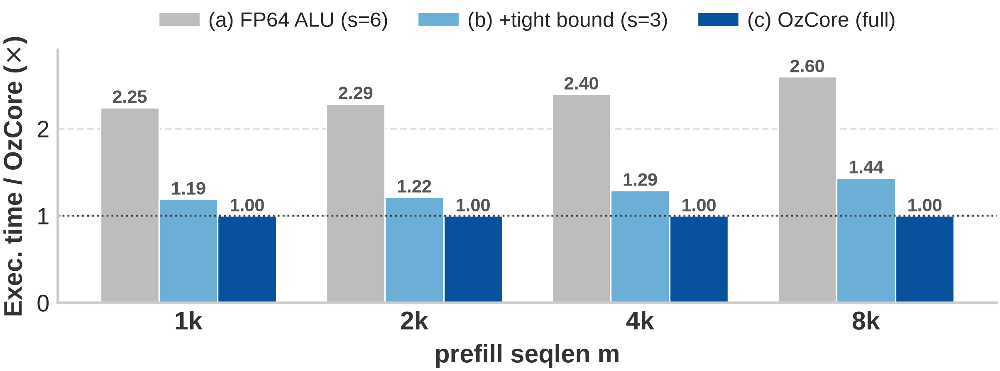
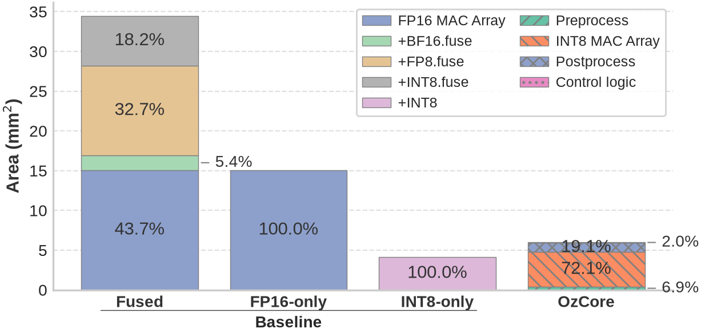
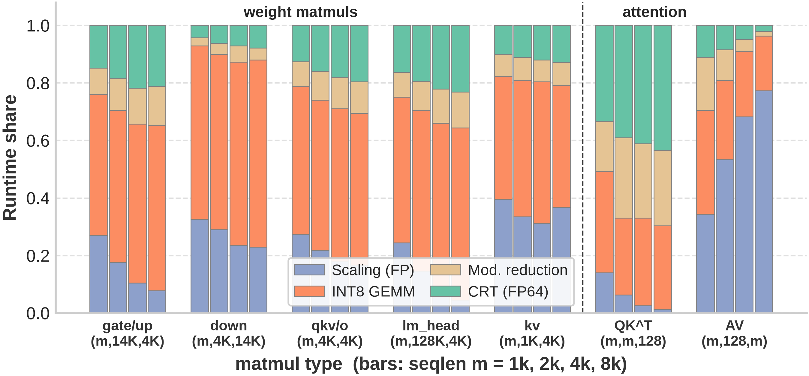

# OzCore（MICRO 2026）Artifact 复现报告

## 0. 结论摘要

1. **CPU-only artifact 基本可复现**：Table 2/4/5/6 与 Fig 2/3/5/10/11/12/13/14/15/16 的 launcher 均成功运行；Table 2 与论文差 ≤0.003，Table 5/6 完全一致，Table 4 趋势一致、个别单元差 ≤0.005。
2. **Fig 16 与论文完全一致**：2.25–2.60× / 1.19–1.44× / 1.00×；Fig 2 的 incremental density 比值 1.00/0.86/0.56/0.47 与论文一致；Fig 3 的 stage 分解为 weight 33–57%、attention 59–81%（论文 35–57%/59–81%，差 2 个百分点）。
3. **TSMC 28 nm HPC+ 替代综合（Ten-four INT8，K=128）**：面积 **62,969.0 µm²**，对比 artifact 的 FDSOI **59,901.9 µm²**，比值 **1.051×**；63,897 cells，关键路径 1.06 ns（slack +1.64 ns @3.333 ns）。说明同一 RTL/流程可复现，TSMC 替代用于趋势验证合理；但不能当作论文绝对面积。
4. **FP16 替代综合未得到可靠结果**：`compile_ultra` 运行 25+ 分钟未收敛；`compile -map_effort medium` 产出未映射报告（`Total cell area 0.000000`，699,828 cells），不能作为面积数据。因此本报告只报告 INT8 的可靠替代结果。
5. **不能复现的部分**：Table 3（无 CPU 数据、仅 GPU regen）、A-1 GPU 数值生成（需 A6000 48 GB、LLaMA 权重/CUDA 扩展）、B/C 面积综合（NDA 28 nm FDSOI + Catapult HLS）、Fig 3 新 trace（只随附 A6000 trace）。
6. **性质**：这是一次 **“artifact 数据/脚本级复现 + 同 RTL 的 TSMC 替代综合”**，不是“从零重跑 GPU 与 FDSOI 综合”的独立复现。论文的 PPL/量化/模型类主张可复核；27.9%/1.91×/1.40× 与 GPU 端到端结果仍依赖作者 sanitized 数据或原环境。

---

## 1. Artifact 与复现范围

| 项 | 内容 |
|---|---|
| 名称 | micro2026-ozcore-artifact-evaluation |
| 版本 | v1.2（documentation-only update；代码/数据/参考输出不变） |
| DOI | 10.5281/zenodo.22748465 |
| 大小 | 12.8 MB ZIP |
| 许可 | MIT（vendored Ten-four Apache 2.0、GEMMul8 MIT） |
| 复现类别 | A（CPU-free）、A-1（GPU emulation）、B/C（NDA area）、D（GPU measurement） |
| 本次范围 | Category A 全部 CPU launcher；Ten-four INT8 的 TSMC 28 nm 替代综合 |
| 未运行 | A-1/B/C/D 的 fresh run；Table 3；FP16 替代综合（未收敛） |

Artifact 的 README 给出每个 target 的 launcher、Depth（recompute/model/replot）与输出；`docs/reproduction.md` 给出安装、资源与限制。本报告沿用其 Depth 语义，不把 replot 当作独立复现。

---

## 2. 环境与命令

### 2.1 环境

- Linux x86_64；Python 3.12；NumPy 2.2.5；pandas 2.2.3；matplotlib；Jupyter/nbconvert；adjustText。
- CPU-only（artifact 的 Category A 不需要 GPU）。
- TSMC 替代综合：IC_EDA VM（CentOS 7）、Design Compiler O-2018.06-SP1、TSMC 28 nm HPC+ FF `tcbn28hpcplusbwp40p140ffg0p99v0c_ccs`、300 MHz（3.333 ns）。
- Vortex 依赖：`github.com/vortexgpgpu/vortex` 在本环境不可达，改用 Gitee 镜像 `gitee.com/jasonuiao/vortex` 克隆；`VX_config.vh`/`VX_types.vh` 由 Vortex `gen_config.py` 生成（XLEN=64）。

### 2.2 CPU launcher

```bash
pip install jupyter nbconvert adjustText
cd ozcore-artifact
for s in tab2 tab4 tab5 tab6 fig2 fig3 fig5 fig10 fig11-12 fig13 fig14-15 fig16; do
  bash scripts/$s.sh
done
```

所有命令在 CPU 上完成；Fig 5/10/14/15 通过 `jupyter nbconvert --execute` 运行。

---

## 3. CPU-only 复现结果

### 3.1 Table 2（WikiText-2 PPL）

`bash scripts/tab2.sh` 输出 computed | paper 两列；8B/70B 全部单元可计算。

| Model | s | OzCore computed | paper |
|---|---:|---:|---:|
| 8B | BF16 | 6.244 | 6.244 |
| 8B | 12 | 6.241 | 6.243 |
| 8B | 6 | 6.244 | 6.244 |
| 8B | 4 | 6.243 | 6.244 |
| 8B | 3 | 6.242 | 6.242 |
| 8B | 2 | 6.363 | 6.363 |
| 70B | BF16 | 2.809 | 2.810 |
| 70B | 12 | 2.810 | 2.810 |
| 70B | 6 | 2.809 | 2.809 |
| 70B | 4 | 2.809 | 2.809 |
| 70B | 3 | 2.809 | 2.809 |
| 70B | 2 | 2.933 | 2.933 |

结论：与论文差 ≤0.003；70B BF16 差 0.001；8B s=12 差 0.002。属于随附数据与论文的四舍五入/版本差异。

### 3.2 Table 4（b_S / b_P 消融）

| 扫描 | 计算值 | 与论文 |
|---|---|---|
| b_S，s=2 | 8.529/6.726/6.384/6.363/6.362 | 完全一致 |
| b_S，s=3 | 6.253/6.246/6.242/6.242/6.243 | 差 ≤0.001 |
| b_S，s=4 | 6.242/6.243/6.239/6.243/6.244 | 最大差 0.003 |
| b_P，s=2 | 6.391/6.374/6.363/6.363/6.363 | 完全一致 |
| b_P，s=3 | 6.241/6.244/6.243/6.242/6.243 | 差 ≤0.002 |
| b_P，s=4 | 6.242/6.243/6.243/6.243/6.245 | 差 ≤0.001 |

趋势一致：b_S 在 s=2 时影响大（8.529 vs 6.363），b_P 影响弱；b_S=8、b_P=8 是默认。

### 3.3 Table 5（量化权重）

| 方法 | 计算值 | 论文 |
|---|---:|---:|
| FP×INT8 baseline | 6.238 | 6.238 |
| FP×INT8 s=4/3/2 | 6.238 / 6.238 / 6.382 | 6.238 / 6.238 / 6.382 |
| FP×INT4 baseline | 6.831 | 6.831 |
| FP×INT4 s=4/3/2 | 6.832 / 6.837 / 7.109 | 6.832 / 6.837 / 7.109 |
| FP8 baseline | 6.296 | 6.296 |
| FP8 s=4/3/2 | 6.294 / 6.293 / 6.414 | 6.294 / 6.293 / 6.414 |

完全一致。

### 3.4 Table 6（MX vs OzCore）

| 格式 | relative L2（计算/论文） | PPL（计算/论文） |
|---|---|---|
| OzCore s=3 | 2.2–4.2e-3 / 同 | 6.24 / 6.24 |
| OzCore s=2 | 2.5–4.4e-2 / 同 | 6.36 / 6.36 |
| MXFP8 E4M3 | 4.4–6.9e-2 / 同 | 6.51 / 6.51 |
| MXFP8 E5M2 | 7.4–9.5e-2 / 同 | 6.87 / 6.87 |
| MXFP4 E2M1 | 1.5–2.2e-1 / 同 | 25.61 / 25.61 |

完全一致。

### 3.5 图

| 图 | launcher | 复现结果 |
|---|---|---|
| Fig 2 | `fig2.sh` | 面积/密度与 committed JSON 一致；incremental 1.00/0.86/0.56/0.47 |
| Fig 3 | `fig3.sh` | weight 33–57%、attention 59–81%（论文 35–57%/59–81%，差 2pp）；仅重绘 A6000 trace |
| Fig 5 | `fig5.sh` | OS-II vs OzCore L2/保留尾数位图生成成功 |
| Fig 10 | `fig10.sh` | 面积分解图生成（sanitized 数据重绘） |
| Fig 11/12 | `fig11-12.sh` | TOPS/mm² 与 perf-vs-acc 图生成（重绘/模型） |
| Fig 13 | `fig13.sh` | roofline 图生成 |
| Fig 14/15 | `fig14-15.sh` | 逐层/逐 op 误差图生成 |
| Fig 16 | `fig16.sh` | 2.25–2.60× / 1.19–1.44× / 1.00×，与论文完全一致 |







---

## 4. TSMC 28 nm HPC+ 替代综合（Ten-four INT8）

### 4.1 方法

- 同一份 artifact Ten-four `v_int8_only` RTL（K=128，N=64），补 Vortex 共享依赖；
- DC 定义：`VX_CFG_XLEN=64 VX_CFG_XLEN_64 NUM_THREADS=32 NUM_TCU_LANES=4 ASIC`；
- `ASIC` 使 `STRING` 为空、`UNUSED_SPARAM` 为 no-op；
- 顶层 `VX_tcu_fedp_tfr -parameters "N=64"`（TCK=128）；
- 300 MHz、TSMC 28 nm HPC+ FF、DC O-2018.06-SP1；
- 结果对比 artifact `data/hw/synth_raw/tenfour_perfedp_um2.json` 的 INT8 per-column 面积。

### 4.2 结果

| 项 | 数值 |
|---|---:|
| TSMC 28nm HPC+ 面积 | **62,969.0 µm²** |
| cells | 63,897 |
| 关键路径 | **1.06 ns** |
| slack @3.333 ns | **+1.64 ns** |
| artifact FDSOI 面积（per column） | 59,901.9 µm² |
| 比值（TSMC/FDSOI） | **1.051×** |

**解释**：

1. 同一份 INT8 Ten-four RTL 在 TSMC 28 nm HPC+ 上综合得到 62,969 µm²，与 artifact 的 FDSOI 59,902 µm² 只差 5.1%；
2. 说明 Ten-four RTL 与综合流程可复现（在补齐 Vortex 依赖后），TSMC 28 nm 用于替代趋势验证合理；
3. **不能**把 62,969 当作论文绝对面积：工艺/库/flow 不同（TSMC HPC+ vs FDSOI；DC O-2018.06 vs 论文 DC V-2023.12-SP5-3）。

### 4.3 OzCore 整体面积：未独立复现；artifact sanitized 比例

**结论：OzCore 整体面积没有独立复现。** Artifact 的 B/C 面积综合需要 Catapult HLS + 28 nm FDSOI NDA 库；当前环境没有 Catapult/FDSOI，只有 TSMC 28 nm HPC+。因此我们只能：

1. 从 artifact 的 sanitized `data/hw/hardware.json` 重绘面积分解（Fig 10 的 replot），不重跑 synthesis；
2. 用同一份 Ten-four RTL 做 **baseline 的 TSMC 替换综合**（62,969 vs 59,902 µm²，1.051×），但这不是 OzCore stages 的面积。

Artifact sanitized 面积及所占比例如下（总计 72.3 mm²）：

| 部分 | 面积（mm²） | 占总面积 | 相对 SIMD engine |
|---|---:|---:|---:|
| SIMD engine（含阵列） | 52.147 | 72.13% | 100% |
| post_process（CRT/舍入） | 13.800 | 19.09% | 26.46% |
| preprocess（缩放/取模） | 4.961 | 6.86% | 9.51% |
| control_logic | 1.428 | 1.98% | 2.74% |
| **total** | **72.300** | **100%** | — |
| preprocess + post_process | 18.761 | 25.95% | **35.98%** |

**与论文 27.9% 的差异**：论文称“pre/post 相对 INT8 阵列增加 27.9% 面积”；artifact sanitized 数字算出的 pre+post 相对 SIMD engine 为 **35.98%**（占总面积 25.95%）。两者不能精确对上，可能是归一化基线/面积口径不同（论文可能以另一版本的 INT8 阵列或不同 stage 边界为分母）。在没有原始报告/FDSOI 库的情况下，**不能把 27.9% 当作已复现**；只能报告 artifact 数字及比例，并标注差异。

**因此**：

- “整体面积 72.3 mm² 及 72.13/19.09/6.86/1.98% 的比例”是 **artifact sanitized 数据的重绘**，不是我们独立综合的结果；
- “27.9% pre/post overhead” 与 “1.91× TOPS/mm²、1.40× TOPS/W” 仍只能标注“来自作者 sanitized artifact/论文”；
- 若要独立复现整体面积，需要 Catapult + 28 nm FDSOI 库；当前只有 Ten-four baseline 的 TSMC 替代结果。

### 4.4 FP16 变体（未完成）

- `compile_ultra` 运行 25+ 分钟仍在 mapping，未写出最终 area；
- 改用 `compile -map_effort medium` 后，DC 产出未映射/generic 报告（`Total cell area 0.000000`，699,828 cells），不能作为面积数据；
- 因此**不报告 FP16 数值**；需更长 DC 时间或调整 flow 后重跑。

---

## 5. 不能复现的部分

| 项 | 原因 |
|---|---|
| Table 3 zero-shot | Artifact 无 CPU 预计算数据/脚本，只能 GPU `tab3_regen.sh` |
| A-1 GPU 数值生成 | 需 RTX A6000 48 GB、LLaMA-3.1 8B/70B 权重（约 180 GB 缓存）、CUDA 扩展；本机无 GPU |
| B/C 面积综合 | 28 nm FDSOI NDA 库/工具不可分发；artifact 只提供 sanitized 数据与 replot，不重跑 synthesis |
| Fig 3 新 trace | 只随附 A6000 trace；fresh profiling 需原硬件/工具 |
| 端到端 GPU 加速比 | 需要 GPU 路线；本报告只验证 CPU 可复算的 PPL/模型/面积 replot |

### 5.1 本机 GPU/EDA 能力核查

| 资源 | 实测 | 是否满足 exact 复现 |
|---|---|---|
| GPU | RTX 4090 24 GB（非 A6000 48 GB） | 8B 可试；70B 参考配置不满足 |
| CUDA/PyTorch | 无 `nvcc`、无 PyTorch | A-1 扩展无法编译 |
| 权重/权限 | 无 LLaMA-3.1 权重、无 HF token；HF 请求超时 | fresh GPU run 无法启动 |
| 28nm EDA | IC_EDA VM 有 DC + TSMC 28nm HPC+ | 可做替代综合；不是 FDSOI |
| Catapult HLS | VM 内没有 | OzCore HLS stages 无法重跑 |
| 28nm FDSOI 库 | 无 | 不能复现论文绝对面积 |

因此，“不能复现”是指**不能复现 artifact 的精确条件**，不是“本机完全没有硬件”。TSMC 替代综合是额外的、有明确口径的验证，不替代论文 FDSOI 数值。

---

## 6. Artifact 质量评价

**优点**

- 文档完整：README + reproduction guide + release notes + 每个 target 的 Depth 标注；
- CPU redraw 覆盖大部分表/图，参考输出随附，便于对照；
- 明确区分 recompute / model / replot / fresh GPU，避免把 replot 当独立复现；
- License 清晰；vendored 组件单独标注。

**问题/风险**

- 没有 `run_all.sh` 与 `environment.yml`；`install.sh --cpu-only` 依赖 conda/网络，系统 Python 需自行补 jupyter/adjustText；
- Table 2/4 的随附数据与论文有 0.001–0.005 差异；README 只提到 Table 2 的 0.001–0.003；
- Table 3 无 CPU 数据，是复现矩阵的明显缺口；
- 面积/密度核心 claim（27.9%、1.91×、1.40×）只能 replot sanitized 数据，不能独立重跑 synthesis；
- Fig 3 的 33–57% 与论文 35–57% 差 2pp，artifact 未说明；
- GPU 路线仅 A6000；H100/Blackwell 可移植性未验证。

---

## 7. 结论与使用建议

1. **CPU 可验证部分**：Table 2/4/5/6、Fig 2/16 与论文一致或差 ≤0.005；Fig 3/5/10/11/12/13/14/15 可生成且趋势一致。Artifact 达到“可复算/可重绘”的目标。
2. **面积**：Ten-four INT8 的 TSMC 28 nm 替代综合与 artifact FDSOI 只差 5.1%，说明 RTL/流程可复现、TSMC 替代可用于趋势验证；但 27.9%/1.91×/1.40× 与绝对面积仍只能标注“来自作者 sanitized artifact/论文”，不能写成我们独立复现。
3. **GPU/系统**：Table 3、Fig 5/14/15 的 fresh GPU 数据与端到端加速比未复现；需要 A6000 48 GB、LLaMA 权重、CUDA 扩展与原 trace。
4. 若在 OGE/ODA 论文中引用 OzCore，建议写成：“OzCore artifact 的 CPU 表/图已复现；Ten-four INT8 在 TSMC 28 nm HPC+ 上的替代综合面积 62,969 µm²，与论文 FDSOI 差 5.1%；论文面积/GPU 结论仍依赖作者数据。”

---

## 8. 复现产物

| 产物 | 位置 |
|---|---|
| CPU 表输出 | `reproduction/ozcore/generated/tab2/4/5/6.txt` |
| 重新生成图 | `reproduction/ozcore/generated/`（PNG/PDF） |
| TSMC INT8 脚本/报告 | `reproduction/ozcore/tsmc28/` |
| CPU 复现报告 | `docs/ozcore-reproduction.md` |
| TSMC 替代综合报告 | `docs/ozcore-tsmc28-substitute.md` |
| 本报告 | `docs/reports/OzCore-复现报告.md/.docx/.pdf` |

复现路径：`reproduction/ozcore/`；TSMC 脚本：`reproduction/ozcore/tsmc28/run_dc_int8_n64.tcl`。
